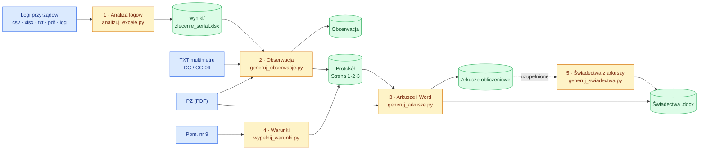
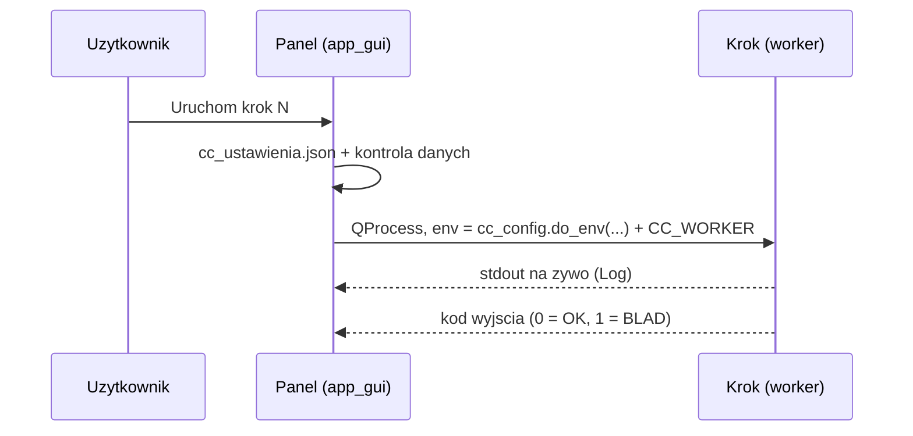
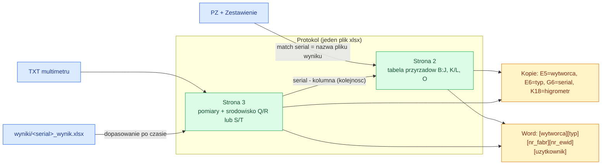

# Generator arkuszy i protokołów wzorcowania (CC / CC‑04)

Zestaw skryptów **Python** automatyzujący pełny obieg wzorcowania termohigrometrów, termometrów
i przetworników w akredytowanym laboratorium pomiarowym: od surowych logów przyrządów, przez analizę
stabilności i protokoły, po arkusze obliczeniowe **Excel** i świadectwa **Word** — spięty
desktopowym panelem **PySide6** i spakowany w jeden plik `ProtokolCC.exe`.

> 📘 **Instrukcja użytkownika** (19 rozdziałów, 13 schematów, wszystkie ustawienia):
> [`DOKUMENTACJA/instrukcja-uzytkownika.html`](DOKUMENTACJA/instrukcja-uzytkownika.html) · [PDF](DOKUMENTACJA/instrukcja-uzytkownika.pdf)
>
> 🎞️ **Prezentacja** (19 slajdów A4, do pokazania zespołowi):
> [`DOKUMENTACJA/prezentacja-skrypty.html`](DOKUMENTACJA/prezentacja-skrypty.html) · [PDF](DOKUMENTACJA/prezentacja-skrypty.pdf)
>
> 🛠️ **Dokumentacja techniczna** (architektura, kontrakty danych, Excel COM, spis funkcji):
> [`DOKUMENTACJA/infografika-projektu.html`](DOKUMENTACJA/infografika-projektu.html)
>
> Tabele ustawień, modułów i funkcji generuje z kodu `DOKUMENTACJA/aktualizuj_dokumentacje.py` —
> uruchom go po zmianach (aktualizuje też tabelę modułów poniżej).

---

## 🗺️ Obieg — pięć kroków



| Krok | Wejście | Wynik |
|---|---|---|
| **1 · Analiza logów** | logi w `excel_do_analizy/` (11+ formatów) | `wyniki/<zlecenie>_<serial>…xlsx` — `Czas \| t \| RH`, zestawienie |
| **2 · Obserwacja** | TXT multimetru, `wyniki/`, PZ, Zestawienie, (pliki 1586A przetworników) | obserwacja z oknami punktów, protokół (Strona 1–3) |
| **3 · Arkusze i Word** | protokół, szablony, Wzory/Obliczenia, Pom. nr 9 | arkusz obliczeniowy na przyrząd, świadectwa Word |
| **4 · Warunki** | protokół, Pom. nr 9 | t/RH pomieszczenia (F/G) dla każdego punktu |
| **5 · Świadectwa z arkuszy** | uzupełnione arkusze w `Etap_5_ark_obl_to_word/` | świadectwa obok arkuszy |

Typy przyrządów w kroku 3: **termohigrometr / termometr**, **przetwornik** (wyjście mA/V: t, RH, t + RH),
**przyrząd z wyświetlaczem i wyjściem** (jeden arkusz `TH + Przetwornik`, świadectwo z pięcioma tabelami).

---

## 🖥️ Panel sterujący — jak się go używa

Okno prowadzi przez obieg krok po kroku (lewa listwa), a każdy krok ma własny formularz:

| Strona | Co robisz |
|---|---|
| **Przygotowanie** | Lista kontrolna plików wejściowych z ich **wiekiem** — `Wzory.xls` sprzed wielu dni dostaje pomarańczowe „ZAKTUALIZUJ przed uruchomieniem”. |
| **1 · Analiza logów** | Zaznaczanie plików z `excel_do_analizy/` (wybór zapamiętywany, nowe pliki niezaznaczone). |
| **2 · Obserwacja** | Zaznaczanie plików TXT multimetru; podpisy, szablony, PZ, filtr, zdjęcia; **2a · Przetworniki** — pliki 1586A i karty przetworników. |
| **3 · Arkusze i Word** | Protokół, szablony, etapy, numer i numeracja świadectw, higrometr K18, podpisy, czujniki komór, szablony Word. |
| **4 · Warunki środowiskowe** | Protokół i czujnik pomieszczenia. |
| **5 · Świadectwa z arkuszy** | Folder arkuszy, numer początkowy, numeracja. |
| **Zaawansowane** | Okno analizy, suszenie, korekta zegara, filtr kolorów, pliki linkowane, stabilność Excela. |

Na dole: **Log** (na żywo, kolorowany, zapisywany do pliku) i **Utworzone pliki** (co powstało/zmieniło się,
jakie ma zakładki). Każdy krok uruchamia się **własnym przyciskiem**; przed startem panel pokazuje listę
zastrzeżeń (brak plików, niezaznaczone logi, istniejący protokół…). Nadpisywane pliki trafiają do
`kopie_zapasowe/`, a plik otwarty w Excelu jest najpierw zapisywany i zamykany. **Jeden krok naraz** —
dwa przebiegi kroku 3 zamykają sobie nawzajem Excele.

## ▶️ Uruchamianie — jeden exe, sześć trybów

Panel uruchamia kroki jako podprocesy. W zamrożonym `.exe` ten sam plik pełni rolę panelu i kroku —
o trybie decyduje `CC_WORKER`: puste = panel, `analiza`, `obserwacje`, `arkusze`, `warunki`, `swiadectwa`.



---

## 🔗 Interakcje danych — Strona 2 ↔ Strona 3



**Reguła sprzężenia:** i‑ty przyrząd na Stronie 2 (wiersz 11+i) odpowiada i‑tej parze kolumn
pomiarowych na Stronie 3 (S:T, U:V… dla CC‑04). Liczba przyrządów = liczbie kolumn pomiarowych.
Rozdzielczość K/L: z Zestawienia (producent+typ), a gdy brak — z wahania cyfr po przecinku w danych.

---

## 📦 Moduły

<!-- AUTO:moduly_md -->
| Plik | Linie | Funkcje | Rola |
|---|---:|---:|---|
| `analizuj_excele.py` | 1807 | 50 | Universal Excel/CSV parser for temperature & humidity data loggers. |
| `app_entry.py` | 95 | 3 | punkt wejscia zamrozonej aplikacji (PyInstaller, jeden .exe). |
| `app_gui.py` | 1147 | 51 | panel sterujacy calym obiegiem wzorcowania (PySide6). |
| `cc_config.py` | 712 | 16 | jedno zrodlo prawdy o ustawieniach calego obiegu. |
| `cc_excel.py` | 360 | 19 | wlasne instancje Excela: uruchomienie i PEWNE zamkniecie. |
| `cc_kopia.py` | 57 | 2 | kopia zapasowa pliku PRZED jego nadpisaniem. |
| `cc_szablon_przetwornika.py` | 536 | 21 | szablon arkusza obliczeniowego dla PRZETWORNIKA. |
| `cc_widgets.py` | 1385 | 79 | elementy interfejsu panelu (app_gui.py). |
| `cc_widok.py` | 145 | 4 | jedno miejsce, w ktorym ustalamy WYGLAD OKNA gotowego pliku .xlsx. |
| `generuj_arkusze.py` | 5258 | 161 | Automatyczne tworzenie kopii arkuszy obliczeniowych na podstawie pliku protokołu. |
| `generuj_obserwacje.py` | 4601 | 141 | Tworzy arkusz obserwacji CC na podstawie pliku TXT z danymi pomiarowymi. |
| `generuj_swiadectwa.py` | 369 | 15 | krok 5: swiadectwa Word z GOTOWYCH arkuszy obliczeniowych. |
| `pz_dane.py` | 1616 | 61 | wspolny modul do wczytywania danych przyrzadow z: |
| `wypelnij_warunki.py` | 177 | 4 | krok 4: warunki srodowiskowe w protokole. |
| `testy/` | — | 923 testów | 50 plików `test_*.py` (unittest) |
<!-- /AUTO:moduly_md -->

## 📥 Obsługiwane formaty loggerów (`analizuj_excele.py`)

`tempmate (PDF)` · `PuTTY/Vaisala (.log)` · `Rotronic HW4` · `ALMEMO` · `Comet/TFA` ·
`xTHERM (COM)` · `HOBO` · `Aranet` · `ElogVis` · generyczny `CSV` / `TXT` / `Excel`.

Generyczny parser radzi sobie też z plikami, w których nagłówek danych stoi **pod blokiem
opisowym loggera** (np. `KH30`), oraz z kanałami nazwanymi ogólnie (`Ch1_Value | Ch1_Unit`),
gdzie wielkość rozpoznawana jest po **jednostce** w sąsiedniej kolumnie. Gdy czas podany jest
i w UTC, i lokalnie — do wyniku trafia **czas lokalny**.
Wynik zawsze znormalizowany: **`Czas | Temperatura [°C] | Wilgotność [%RH]`**.

## 🔌 Kontrakt env‑var (GUI ↔ workery)

**Nie ma już potrzeby edytowania skryptów w Notatniku.** Wszystkie ustawienia (94)
opisuje rejestr w [`cc_config.py`](cc_config.py) (typ, wartość domyślna, etykieta,
opis, krok obiegu, poziom podstawowy/zaawansowany). Panel buduje z niego formularze
automatycznie, zapisuje wybory do `cc_ustawienia.json` i przekazuje je workerowi
przez zmienne środowiskowe. Stałe w skryptach pełnią rolę **wartości domyślnych** —
uruchomienie `python generuj_obserwacje.py` bez panelu działa jak dawniej.

| Prefiks | Zakres | Przykłady |
|---|---|---|
| `CC_WORKER` | tryb exe | `analiza` / `obserwacje` / `arkusze` / `warunki` / `swiadectwa` / (puste = GUI) |
| `CC_*` | wspólne | `CC_FOLDER`, `CC_PROTOKOL`, `CC_SZABLON`, `CC_PZ_FOLDER`, `CC_ZESTAWIENIE` |
| `ANL_*` | krok 1 — analiza | `ANL_PLIKI`, `ANL_INPUT`, `ANL_OUTPUT`, `ANL_DEBUG` |
| `OBS_*` | krok 2 — obserwacja | `OBS_TXT_FILES`, `OBS_PODPIS`, `OBS_STAB_PO_RH`, `OBS_PROG_T`, `OBS_KOREKTA_ZEGARA`, `OBS_FOTO`, `OBS_FOTO_ZRODLO`, `OBS_FOTO_CEL`, … |
| `GEN_*` | krok 3 — arkusze/Word | `GEN_EXCEL`, `GEN_WORD`, `GEN_POMIJAJ_PUSTE`, `GEN_NR_SW`, `GEN_NR_SW_WG_EWID`, `GEN_K18_CC`, `GEN_PODPIS_1`, `GEN_MAP_CC04`, `GEN_KOLOR_AKT`, … |

Konwersję typów robią helpery `cc_config.flaga / liczba / calk / tekst / minuty /
lista / tabela / sciezka` — niepoprawna wartość cofa się do domyślnej zamiast wywalać skrypt.

---

## 🚀 Uruchomienie

```powershell
# Z źródła (panel GUI):
.venv\Scripts\python.exe app_gui.py

# Pojedyncze skrypty:
.venv\Scripts\python.exe analizuj_excele.py            # excel_do_analizy/ -> wyniki/
.venv\Scripts\python.exe generuj_obserwacje.py         # TXT -> obserwacja + protokol
.venv\Scripts\python.exe generuj_arkusze.py            # protokol -> kopie + Word

# Budowa jednego .exe:
powershell -ExecutionPolicy Bypass -File build.ps1     # -> dist\ProtokolCC.exe
```

### 🧪 Testy

```powershell
# Wszystko (z krokiem 3 — uruchamia Excel, ok. 3 min):
.venv\Scripts\python.exe -m unittest discover -s testy -t testy

# Szybko, bez Excela:
$env:CC_TESTY_SZYBKIE=1; .venv\Scripts\python.exe -m unittest discover -s testy -t testy
```

**923 testów** na czystym `unittest` (bez dodatkowych zależności), w tym pełny
obieg 1 → 2 → 3 na prawdziwym pomiarze 188. Wszystko dzieje się w
`testy/_piaskownica/` — testy nie dotykają plików projektu. Szczegóły:
[`testy/README.md`](testy/README.md).

Najważniejszy jest `testy/test_kontrakt.py`: pilnuje, że **każde** ustawienie
widoczne w panelu naprawdę zmienia stałą w skrypcie (i że bez panelu obowiązuje
wartość domyślna). Dodanie ustawienia do rejestru bez podłączenia go do skryptu
wywala suite.

**Wymagania środowiska:** Windows 10/11, zainstalowany **Excel** (xlwings/COM),
dostęp do sieciowego `\\plum4\LabPomiarowe\Wzory.xls`. Zależności: `requirements.txt`
(`openpyxl · xlwings · python-docx · PySide6 · pandas · pypdf`).

### Sterowanie etapami (`generuj_arkusze.py`)

Przełączniki `Generuj arkusze Excel` / `Generuj swiadectwa Word` w kroku 3 panelu
(env `GEN_EXCEL` / `GEN_WORD`): `wł/wł` = pełny obieg · `wł/wył` = tylko Excel ·
`wył/wł` = Word z już istniejących kopii.

### Warianty protokołu CC‑04

- Kolumny E/F na Stronie 3: CC = `Q/R`, CC‑04 = `S/T` (kolejne kopie +2 w prawo).
- Typ CC‑04 z wiersza 14 (`S:T14`…): tagi `LG` / `LD` / `PD` / `PG` → stałe `K11–K17`
  (Pt100‑09/01/18/13, 1586A‑02, …).

### 👁️ Wygląd pliku wynikowego — pasek zakładek

> **Zasada: każdy `.xlsx`, który oddajemy użytkownikowi, przechodzi na końcu przez
> [`cc_widok.py`](cc_widok.py) → `wymus_widok()`.** Jedno wywołanie na plik,
> **po wszystkich zapisach — także tych przez Excel COM.**

Chodzi o trzy atrybuty w `xl/workbook.xml`:

| Atrybut | Znaczenie | Co ustawiamy |
|---|---|---|
| `tabRatio` | szerokość paska zakładek (0–1000) kosztem paska przewijania | `GEN_TAB_RATIO` × 1000 (domyślnie **850**) |
| `firstSheet` | od której zakładki zaczyna się widoczny pasek | **0** — zawsze od pierwszej |
| `activeTab` | zakładka otwarta po wczytaniu | bez zmian (kopia otwiera się na `Wyniki`) |

**Dlaczego tak, a nie przez okno Excela.** Objaw — po otwarciu pliku widać jedną
zakładkę, a resztę trzeba odsłonić przeciągając suwak w lewo — wracał dwiema drogami:

1. **Protokół gubił `tabRatio`.** Krok 3 otwiera protokół przez COM (wpisanie F/G do
   Strony 3) i przy zapisie Excel przepisuje `<workbookView>` po swojemu, kasując ten atrybut.
2. **Kopie gubiły `firstSheet`.** Przewijanie szło przez żywe okno
   (`Windows(1).ScrollWorkbookTabs`) i bywało nieskuteczne — w jednym przebiegu dwie
   kopie z czterech wychodziły z `firstSheet=6`, czyli paskiem przewiniętym na sam
   koniec, do zakładki `Wyniki`.

Dlatego poprawka jest **chirurgiczna i deterministyczna**: `.xlsx` to archiwum ZIP,
więc podmieniamy w nim jedną część — `xl/workbook.xml`. Reszta zostaje bajt w bajt,
razem z **zapamiętanymi wynikami formuł** (ponowny zapis przez `openpyxl` skasowałby
ten cache, a świadectwa Word czytają właśnie policzone wartości).

**Gdzie to jest wpięte** — dwa miejsca, oba „na końcu":

- `generuj_obserwacje.py` → `_zapisz_bezpiecznie()` — jedyny punkt zapisu kroku 2,
  więc obejmuje arkusz obserwacji, protokół i zestawienie pomiarów.
- `generuj_arkusze.py` → koniec `_main_impl()` — protokół + wszystkie kopie, po Etapie 7.
  W logu: `[Widok] Pasek zakładek ustawiony w N z M plików`.

**Dodając nowy plik wynikowy** — wywołaj `cc_widok.wymus_widok(ścieżka, TAB_RATIO)`
jako ostatni krok, po zapisie. Testy: [`testy/test_widok_zakladek.py`](testy/test_widok_zakladek.py)
oraz `test_obieg.py::test_3_pasek_zakladek_widoczny_w_kazdym_pliku`.

## 🆕 Ostatnie usprawnienia

- **Przyrząd z wyświetlaczem i wyjściem analogowym = jeden arkusz** (zlecenie 239, VAISALA PTU303
  D4850103): gdy na Stronie 2 są dwa wiersze z tym samym nr fabrycznym — jeden z rozdzielczością odczytu
  (wyświetlacz, °C/%), drugi ze skalowaniem (wyjście V/mA) — krok 3 robi jeden arkusz z szablonu
  `… - 1 - TH + Przetwornik (CC).xlsx` (ustawienie `CC_SZABLON_TH_PRZETW`): w zakładkach E/F z
  wyświetlacza, G/H z wyjścia, K10 `TH/Przetwornik`, kanały/zakres jak dla przetwornika (punkt samej
  temperatury: K16 `-`). *Wyniki* 1:1 jak w ręcznie przygotowanym arkuszu — trzy sekcje (wyświetlacz 239/246,
  wyjście w °C/% 253/260, wyjście w V 274/279) z kryteriami zgodności; krok 3 zmienia tylko liczbę wierszy
  i nazwy zakładek. Świadectwo jak termohigrometru (wyniki z wyświetlacza). Szablon z ręcznego wzoru:
  `python cc_szablon_przetwornika.py --th <arkusz wzorcowy>`.
- **Świadectwo przyrządu z wyświetlaczem i wyjściem** (`xxx_yyy_LA_TH_2026 - TH + przetwornik (ang).docx`,
  ustawienie `GEN_WORD_TH_PRZETW`, zbudowany z wydanego 1276/239/LA/TH/2026): pięć tabel wyników = sekcje
  *Wyników* arkusza (wyświetlacz t+RH i t, wyjście w °C/%, wyjście w V/mA t+RH i t) z kolumną zgodności
  pass/fail; przypis o punkcie powtórzonym, daty po angielsku, rok produkcji z PZ
  (`year of production` / `rok produkcji`), voltage/current i V/I/mA wg L10. Sprawdzone na 239: tabele
  i treść 1:1 z wydanym świadectwem. Szablon z innego świadectwa:
  `python cc_szablon_przetwornika.py --word <świadectwo.docx>`.
- **Krok 3: pad Excela przy odczycie kalibracji** (kopie już zapisane) — nowa sesja Excela i ponowna próba,
  zamiast kończyć krok bez świadectw.
- **Obserwacja: data z sekundami we wszystkich wierszach** — szablon ma formaty tylko do wiersza 7421,
  dłuższy pomiar pokazywał niżej `08.11.2026 20:16` zamiast `2026/11/08 20:16:06`; teraz każdy wiersz dostaje
  format pierwszego wiersza kolumny. **Krok 3: linki serwerowe w otwartym arkuszu** — arkusz otwarty w Excelu
  jest zapisywany i zamykany przed przywróceniem linków; nieudana podmiana nie zostawia `.xlsx._xltmp_`.
- **Krok 3 nie wisi na pustych zakładkach z PZ**: zakładki bez pomiarów (E15:H19 puste) mają wyłączone
  przeliczanie — ich formuły (UDF-y Wzory/Obliczenia) na pustych odczytach nie kończyły się (zlecenie 239: >13 min
  na włączeniu trybu automatycznego; z wyłączeniem 0,1 s). Po uzupełnieniu zakładka liczy się normalnie.
  Punkt samej temperatury z PZ nie zabiera już zakładki punktowi z RH (puste „20, 15 (2)”), a błąd odczytu
  protokołu kończy krok kodem błędu (panel nie pisze „zakończono OK”).
- **Krok 2 nadpisuje otwarty protokół / obserwację**: gdy plik z poprzedniego przebiegu jest otwarty
  w Excelu, ten jeden skoroszyt jest zapisywany i zamykany (Excel i inne skoroszyty zostają), a zapisana
  wersja trafia do `kopie_zapasowe`. Wcześniej krok padał `PermissionError` dopiero po całej analizie.
- **Rampa komory nie psuje tolerancji korekty nastawy**: nastawa odniesienia i korekta muszą być trzymane
  ≥ 5 min. Wcześniej krok rampy wejścia (−27,0) był nastawą odniesienia i korekta −27,3 → −27,6 rozcinała punkt;
  a pierwsze kroki rampy wyjścia (do 0,5 °C) doklejały się do końca punktu. Teraz punkt kończy się na początku rampy.
- **Ostrzeżenia o pominiętych logach**: lista plików kroku 1 pamięta poprzedni wybór, a nowe pliki są
  niezaznaczone (zlecenie 232: 14 logów, w protokole 11). Panel przed krokiem 1 wymienia niezaznaczone pliki,
  a krok 2 — logi przyrządów z PZ bez pliku w `wyniki` („NIE trafią do protokołu”).
- **Świadectwo bez nr ewidencyjnego**: gdy nr ewid. jest pusty albo `-` (brak w PZ), z opisu obiektu znika
  cały fragment `, nr ewid.: …` — „nr fabr.: 000007263, wytwórca: …” (jak już działało dla przetworników).
- **Nr fabryczny z nazwy `pomiar_000007263.xlsx`** (eksport Lascar EasyLog): słowo opisowe na początku nazwy
  (`pomiar_`, `dane_`, `eksport_`…) jest odcinane — wcześniej numer nie pasował do PZ i Strona 2 zostawała pusta.
  Plik opracowania z prefiksem kilku zleceń (`233, 240_LA_TH_2026_…`) jest rozpoznawany, więc ponowny krok 2
  nie dokleja już prefiksu drugi raz (a plik nazwany tak podwójnie wraca do właściwej nazwy).
- **Odstęp reprezentantów od zmiany nastawy: 5 min** (było 2, `OBS_ODSTEP_KONIEC`): zegary przyrządów
  spóźniają się czasem o ~2 min względem komory, więc okno kończące się 2 min przed zmianą łapało u nich
  już przejście do kolejnego punktu. Zmiana nastawy o 14:13 → ostatni reprezentant najpóźniej 14:08.
- **Krok 5 · Świadectwa z arkuszy** (`generuj_swiadectwa.py`, folder `Etap_5_ark_obl_to_word`): gotowe arkusze
  obliczeniowe (zrobione bez Worda, uzupełnione po kolejnych pomiarach) → świadectwa Word tak samo jak w kroku 3
  (te same funkcje). Wyniki z arkusza, producent/typ/serial z arkusza, nr ewid./użytkownik/zasilanie z PZ (folder PZ
  albo ten folder), data z K4 zakładek. Warunki środowiskowe — z protokołów z tego folderu oraz z folderu głównego
  (tam tylko protokoły tego samego zlecenia, np. `232_LA_TH_2026 - protokół_2 CC-04`): zakładka trafia
  na blok Strony 3 o tej samej dacie i nastawie — najpierw z protokołu, w którego Stronie 2 jest ten przyrząd
  (zlecenie rozbite na kilka protokołów z tymi samymi punktami jednego dnia), potem z dowolnego
  (kilka protokołów = kilka sesji, np. domiar; nazwy plików dowolne, byle z „protok”), t/RH z F/G albo
  z pliku czujnika. Własny numer początkowy i numeracja wg nr ewid. Świadectwa obok arkuszy; linki arkuszy wracają
  na serwer, poprzednia wersja w `kopie_zapasowe`. Zlecenie 234: 8/8 świadectw identycznych z krokiem 3.
- **Kopia zapasowa świadectwa** robiona teraz PRZED nadpisaniem — wcześniej po skopiowaniu szablonu, więc
  w `kopie_zapasowe` lądował pusty szablon zamiast poprzedniego świadectwa.
- **Krok 1 bez `WARNING *** file size … not 512 + multiple of sector size`:** komunikat xlrd dla `.xls`
  z programów loggerów (dane czytane poprawnie) nie zaśmieca już logu.
- **Puste pola protokołu na szaro:** Strona 2 — „Uwagi” bez treści dostają `-` na szarym tle; Strona 3 — puste
  komórki czujników wzorcowych (multimetry, t higrometru: K:P w CC-04, K:N w CC) szare, a „Dł. rurki tefl.”
  i „Forma kondensacji” w punkcie tylko-temperatura albo bez odczytów tdp (S8000 wyłączony) → `-` na szarym tle.
- **Nr ewidencyjne w nawiasach w PZ:** `nr fabr.: 36668832 (H1), 36679283 (H2), …` (PZ 232, 80 szt.) → nr ewid.
  H1, H2… Krótki kod z cyfrą bez spacji; dopisek `(kanał pomiarowy nr: 1)` zostaje dopiskiem, etykieta
  `nr ewid.:` ma pierwszeństwo. Sprawdzone na 272 PZ z serwera — zmienił się tylko PZ 232.
- **Ponad 10 przyrządów na Stronie 3:** nowa para kolumn to kopia przedostatniej pary wstawiana PRZED ostatnią
  (jak ręcznie), a nie za nią. Excel sam rozciąga scalone nagłówki „Wskazania” / „Przyrządy wzorcowane”
  (wiersze 8–9), obszar wydruku i podział strony (niebieska linia); ostatnia para z grubą ramką zostaje na końcu,
  wypełnienie do dołu obszaru wydruku jak w szablonie. Wcześniej wszystko kończyło się na 10. parze.
- **Zapas ponad najlepsze okno** (`OBS_ZAPAS_KRYT`, domyślnie 0,05): z okien spełniających kryterium, których
  średni rozrzut (K, dla punktu temperatury L) jest najwyżej o zapas większy od najlepszego, brane jest
  NAJPÓŹNIEJSZE — przyrząd ma więcej czasu, by dojść do nastaw. Najlepsze okno zostaje jasno zaznaczone
  (bez pogrubienia, nie do protokołu) z dopiskiem „Alternatywa…”. Zlecenie 232, 37 °C / 65 %: 13:53–13:57
  (K śr. 0,11) zamiast 12:15–12:19 (0,06). 0 = zachowanie sprzed zmiany.
- **Korekta nastawy T to nadal ten sam punkt** (`OBS_KOREKTA_T`, domyślnie 0,5 °C): operator podciąga nastawę
  (37 → 37,3 → 37,5 → 37,4), żeby lepiej trafić w punkt — wcześniej każda taka zmiana kończyła punkt i okno
  wypadało przed korektą (zlecenie 232: 07:23 zamiast 09:49). Tolerancja liczona od nastawy na początku punktu;
  zmiana nastawy RH zawsze zaczyna nowy punkt. Wejście w widełki i kontrola „komora nie utrzymała nastawy”
  liczone wg nastawy po korekcie. 0 = zachowanie sprzed zmiany.
- **Zakładki dla wszystkich punktów z PZ** (`GEN_PUNKTY_PZ`, domyślnie włączone): punkt zamówiony dla przyrządu,
  bez pomiarów w protokole (brak odczytów albo szare komórki), dostaje pustą zakładkę we właściwym miejscu
  i wiersz w *Wynikach* — wg nominału z nazwy, do domierzenia. Zakładka jest całkiem pusta: bez odczytów komory
  i daty z tego wsadu. Do świadectwa punkt wchodzi dopiero po uzupełnieniu (krok 3 z wyłączonym „Generuj arkusze
  Excel”), także z datą K4 zakładki; nie wpływa na wybór szablonu Word. Warunków środowiskowych domierzonego
  punktu skrypt nie liczy — zakres w świadectwie obejmuje tylko bloki protokołu.
- **Wiersze przyrządów dobierane do pełnych minut punktu:** obserwacja wybiera 5 kolejnych pełnych minut
  (18:19:47 → 18:20, 18:20:46 → 18:21, 18:22:14 → 18:22 …), a logger szukany był po sekundach wiersza multimetru —
  przy zapisie na :25 wychodziło 19:25, 20:25, 22:25 (minuta 21 wypadała). Teraz 20:25, 21:25, 22:25, 23:25, 24:25;
  to samo w oznaczeniach plików wyników i zestawienia.
- **Podpisy obserwacji CC-04:** przy 21 kolumnach danych blok podpisów trafiał w stare komórki X:Y i ich
  czyszczenie zdzierało z daty format i ramkę (`46328` zamiast daty). Teraz czyszczenie idzie przed zapisem,
  a blok przenosi pełny wygląd i szerokość kolumn z szablonu (wcześniej data bywała `########`).
- **Raport Tempmate M1 w `.xls` (zlecenie 234):** krok 1 szuka tabeli po wierszu `No. | Time | Temperature°C`
  (blok `Summary` uchodził za nagłówek), nazwa wyniku z `Serial Number`. Pusty arkusz (`Graph`) jest pomijany
  zamiast kończyć się błędem. Wiersze zdarzeń (`Low Voltage`) i dziury w zapisie → ostrzeżenie w logu,
  temperatura w °F → błąd zamiast cichego przepisania.
- **Dopisek `_LOG 66` w nazwie pliku** (nr ewid. `Q/LOG/66`) nie psuje już dopasowania do PZ:
  `40125624_LOG 66.xls` → serial `40125624`. Typ z PZ bez końcowego dwukropka (`typ: Tempmate M1:`).
- **Numeracja świadectw wg nr ewidencyjnego** (przełącznik w kroku 3, `GEN_NR_SW_WG_EWID`):
  świadectwo o numerze początkowym dostaje przyrząd z najmniejszym nr ewidencyjnym (U90337-18,
  potem -36, -41 …, liczby porównywane jak liczby), a nie z najmniejszym nr fabrycznym. Nr ewid.
  ze Strony 2 (kol. F), a gdy pusty — z PZ; przyrządy bez nr ewid. dostają numery na końcu.
  Wyłączone — numery rosnąco wg nr fabrycznego (liczby jak liczby: 9 < 10). Ten sam przełącznik
  jest w kroku 5 (`SW_NR_SW_WG_EWID`).
- **PZ 233 — przyrządy z PZ nie trafiały na Stronę 2:** nagłówek `Obiekty wzorcowania` bez
  dwukropka, numery rozerwane przez tekst PDF (`371 72104`, `U90337 -18` → `37172104`, `U90337-18`;
  `524000646 04/2025` — numer i data — zostaje rozdzielone) oraz **pozycje od 10)** wzwyż, które
  sklejały się z pozycją 9 i przepadały (PZ 07, 29, 48, 68, 99, 117 … — np. 68: 40 przyrządów zamiast 9).
  Dwucyfrowy numer otwiera pozycję tylko jako następny w kolejności. Sprawdzone na PZ z serwera —
  pozycje 1–8 bez zmian.
- **Excel użytkownika nie jest zamykany:** skrypty uruchamiają i zamykają WYŁĄCZNIE własne
  instancje Excela (`cc_excel.py`). Krok 2 przy usuwaniu bloków protokołu podpinał się pod
  otwartego Excela (`Dispatch`) i zamykał go bez pytania o niezapisane zmiany. Zawieszona
  przy dużym pliku instancja skryptu jest kończona po swoim PID — inne okna Excela zostają.
- **Punkty PZ zapisane bez nawiasu** — `5 °C, (37 °C, 35 %rh); …` (232), `2 °C, (10 °C, 70 %rh) …`,
  `1) 37 °C, z niepewnością …` — oraz lista z jednostką w nawiasie `(-15; -30 °C)`. Wcześniej te punkty
  przepadały i obserwacja ich nie wybierała. Opis niepewności (`Ut (0,2 ÷ 0,4) °C`) nie jest brany za punkt.
  Sprawdzone na 268 PZ z serwera — poza tymi zapisami wynik bez zmian.
- **Szablon przetwornika tylko RH** (`… - 1 - Przetwornik RH (CC).xlsx`, ustawienie `CC_SZABLON_PRZETW_RH`):
  *Wyniki* przeniesione 1:1 z ręcznie przygotowanego pliku (230, 263051 — wygląd, scalenia, szerokości,
  wysokości, formuły); krok 3 zmienia tylko formuły wg punktów. Z innego wzoru:
  `python cc_szablon_przetwornika.py --rh <plik z Wynikami>`.
- **Obserwacja CC z kolumnami przetworników:** blok podpisu (Data / Wykonał/a) przenoszony na prawo od danych
  razem z wyglądem (pogrubienie, ramki, format daty, szerokości), stare komórki dostają wygląd danych.
- **Eksport multimetru (1586A, `Ch NNN (ADC/VDC)`) w kroku 1** nie jest już traktowany jak loger (wcześniej
  Ch 001 stawał się „temperaturą”, a Ch 221 „wilgotnością” jednego przyrządu) — krok 1 go pomija i usuwa stary
  `…_wynik.xlsx`. Krok 2, gdy w 2a nic nie wybrano, sam znajduje takie pliki `.csv` (folder roboczy i folder logów)
  pokrywające się czasem z pomiarem; czyta czas z ułamkiem sekundy. Każdy kanał RH/t = osobny przyrząd.
- **Karty przetworników (krok 2a):** każdy przetwornik to osobna karta (`＋ Dodaj przetwornik`, `✕ Usuń`)
  z polami nazwanymi jak w zakładce arkusza obliczeniowego: rodzaj odczytu (L10), multimetr (K14),
  wejście Ch pomiar Itm/IRHm (K15/K16, `-` = brak wyjścia), zakres przetwornika (M22 ÷ O22),
  tmin/tmax (L27/O27), Rhmin/Rhmax (L28/O28), własny szablon (lista arkuszy `xxx_….xlsx` z folderu). Nowa karta kopiuje poprzednią (bez nr
  fabrycznego i kanału z numerem). Do skryptów trafia ten sam JSON co dawniej.
- **Krok 2a · Przetworniki (panel, krok 2):** plik(i) multimetru z wyjściami przetworników — eksport
  1586A (`dat00001.csv`, kolumny `Ch NNN (ADC)` w A → mA, `(VDC)` w V, `(mA)` wprost) — plus tabela,
  który kanał (t / RH) należy do którego przyrządu. Krok 2 dopasowuje odczyty do wierszy obserwacji
  (najbliższa minuta), dokłada je jako kolumny obserwacji i jako przyrządy na Stronach 2-3 (CC i CC-04).
  Zlecenie 230: 60/60 wartości zgodnych z ręcznie przepisanymi.
- **Świadectwa przetworników — cztery warianty** (szablony z wydanych świadectw, bez danych klientów,
  każdy także w wariancie `(uzytkownik)`): `przetwornik RH` (tylko wyjście RH), `przetwornik T` (tylko t),
  `przetwornik TH` (t + RH, wszystkie punkty z RH) i `przetwornik TH + temp` (t + RH oraz punkty tylko
  temperaturowe — dwie tabele). Krok 3 dobiera wariant wg wyjść przetwornika (K15/K16) i punktów;
  napisy I/U, mA/V, prądu/napięcia, zakresy t/RH/wyjścia i niepewności w mA/V wypełniane automatycznie.
  Brak Uz w Uwagach → w świadectwie `Uz = (UZUPEŁNIJ) V DC.` + ostrzeżenie.
- **Świadectwo przetwornika (tylko RH)** — szablon `xxx_yyy_LA_TH_2026 - przetwornik RH.docx`
  (`GEN_WORD_PRZETW_RH`): kolumna Im/Um, zakres wyjścia, zasilanie Uz z Uwag; wyniki z wiersza 253
  zakładek. Nota o histerezie bierze punkt z PZ (nazwa zakładki), nie zaokrąglony odczyt.
- **Wyniki przetwornika = bloki zakładki** („Wyniki do umieszczenia na świadectwie”): szablon przetwornika ma
  w *Wynikach* tabele z wierszy 253 (t + RH), 260 (t) i 267 (RH), wygląd skopiowany z bloków zakładki.
  Krok 3 zostawia tabele pasujące do przetwornika — t + RH: 253 i 260 (jak 239 + 246 termohigrometru),
  t: 260, tylko RH: 253 z `-` w kolumnach temperatury (Itm, tm, Δt, Ut) jak w ręcznie przygotowanych
  wynikach — nagłówki przepisuje z zakładki (prąd / napięcie), histereza z RHm (I253). Świadectwo bierze wartości z tego samego wiersza zakładki
  z liczbą miejsc wg formatu komórki — zaokrąglenie ustawione w zakładce trafia do świadectwa.
- **Szablon arkusza przetwornika** (`… - 1 - Przetwornik (CC).xlsx`, budowany z szablonu standardowego
  przez `python cc_szablon_przetwornika.py`): *Wyniki* zbierają wiersz 253 zakładek (Itm/IRHm, tm/RHm,
  Δ, U), nagłówki zależą od L10, histereza z RHm (I253). Krok 3 bierze go dla kopii-przetwornika
  (ustawienie `CC_SZABLON_PRZETW`); własny szablon dla konkretnego przetwornika — kolumna
  *Szablon arkusza* w tabeli Przetworniki. Brakujące wyjście (np. bez t) dostaje `-` w *Wynikach*.
  Świadectwo Word dla przetwornika nie jest jeszcze generowane.
- **Kopie zapasowe:** kroki 2–4 przed nadpisaniem protokołu, obserwacji, kopii arkusza i świadectwa
  zapisują poprzednią wersję w `kopie_zapasowe/` (20 najnowszych na plik). Przycisk „Uruchom cały
  obieg” usunięty.
- **Tabela „Przetworniki” w panelu (krok 2)** — wiersz na przetwornik: nr fabryczny, kanał t, kanał RH
  (osobno), multimetr, sygnał (Prąd/Napięcie), zakres wyjścia, tmin/tmax, RHmin/RHmax. Krok 2 wpisuje
  z niej skalowanie (Strona 2, M/N) i kanały (Uwagi), a na Stronie 1 multimetr sygnału analogowego
  (D53/I53/I58). Krok 3 rozpoznaje kopię-przetwornik po jednostce `mA`/`V` w wierszu 19 Strony 3 i
  ustawia: dane w **G/H** (Itm/IRHm) zamiast E/F, K10 `Przetwornik`, L10 `Prąd`/`Napięcie`, K14
  multimetr, K15/K16 kanały, M22/O22 zakres wyjścia, tmin/tmax, RHmin/RHmax. Bez wpisu w tabeli —
  z protokołu (skalowanie M/N, kanały z Uwag, multimetr z Strony 1 I53).
- **PZ jako skrót `.lnk`** w folderze PZ jest czytany; blok `UWAGA: 1) ÷ 6) …` nie tworzy już
  fikcyjnych przyrządów, a napięcie zasilania (`Uz = …`) trafia do Uwag przyrządu.
- **Przetworniki w pliku CC-04** (`Przetwornik U; Wejście pomiarowe Ch: 105`): kanał przetwornika nie
  zajmuje już miejsca czujnika wzorcowego Pt100 i nie ginie, gdy leży poza 101–108 (np. Ch115).
  W obserwacji — osobne kolumny `Wskazania multimetru Przetwornik U ChNNN [V]` obok wskazań
  multimetru. W protokole — osobny przyrząd: para kolumn t/RH na Stronie 3 (który kanał to t, a który
  RH, rozstrzyga przebieg komory), wiersz na Stronie 2 z `-` w rozdzielczości i kanałami w *Uwagach*;
  skalowanie (M/N) do uzupełnienia ręcznie — zakresu wyjścia w PZ nie ma.
- **Log PuTTY z wartościami opisanymi jednostkami** (`1012.9 mbar   22.4 'C   54 %RH`, bez `T=`/`RH=`)
  jest rozpoznawany po jednostkach; ciśnienie pomijane. Układ z etykietami działa jak dotąd.
- **Termometry z PZ (zlecenie 229):** dopisek za producentem (`Testo – wzorcowanie czujnika
  wewnętrznego`) trafia do kolumny *Uwagi*, w *Wytwórca* zostaje `Testo`; *Typ* bez powtórzonego
  producenta (`175T2`); ostatni podpunkt listy bez przecinka nie dokleja już `wytwórca: …` do nr
  ewidencyjnego. Przyrząd bez odczytów RH ma w *Rozdzielczość RH* `-` (zamiast rozdzielczości
  temperatury), *Skalowanie przetwornika* `-`. Pomiar samej temperatury: na Stronie 1 higrometr
  wzorcowy (D12) i rotametr (F64) `-`. Przyrząd z PZ (komora) bez pliku pomiarowego jest zgłaszany.
- **Zawieszone Excele z poprzednich przebiegów:** krok 3 na starcie kończy procesy `EXCEL.EXE`
  bez żadnego widocznego okna, działające dłużej niż minutę (blokowały protokół i kopie).
  Excel z oknem — także zminimalizowany — nie jest ruszany. Wyłącznik: `GEN_SPRZATAJ_EXCEL`
  (Zaawansowane → Stabilność Excela).
- **Krok 4 · Warunki środowiskowe (osobna zakładka):** wpisuje t i RH pomieszczenia z pliku
  `Pom. nr 9 (MX1101-02) - <rok>.xlsx` do Strony 3 wybranego protokołu (kolumny F/G) — dla
  **każdego** punktu, także takiego, w którym żaden przyrząd nie miał odczytów. Krok 3 robił to
  tylko dla bloków, które trafiły do jakiejś kopii arkusza. Nie uruchamia Excela; wypełnione
  wcześniej komórki zostawia, chyba że włączysz *Nadpisuj*. Nie wchodzi do „Uruchom cały obieg”.
- **Pliki kroku 1 z nazwą zlecenia i podpisem:** po zaznaczeniu punktów krok 2 nadaje im
  nazwę `221_LA_TH_2026_<nr fabryczny>_opracowanie danych.xlsx` (zestawienie:
  `221_LA_TH_2026_zestawienie_pomiarow.xlsx`) i dopisuje z prawej strony tabeli podpis
  *Opracował / Data*. Numer zlecenia przyrządu pochodzi z PZ (po nr fabrycznym albo
  ewidencyjnym), a bez PZ — z numeru pomiaru. Gdy PZ leży w folderze już przy kroku 1,
  plik od razu dostaje tę nazwę. Dotyczy tylko plików dopasowanych do punktów pomiaru.
- **Wybrane okna widać też w plikach kroku 1:** wiersze, z których powstał punkt protokołu, są podświetlane w `wyniki/<serial>_wynik.xlsx` — zielono, a przy ostrzeżeniu pomarańczowo (jak w obserwacji), z numerem punktu w kolumnie obok. Dostaje je **każdy** dopasowany czasowo plik, także ten, który nie zmieścił się w kolumnach przyrządów protokołu.
- **Pasek zakładek nie chowa się już po otwarciu pliku:** `tabRatio` i `firstSheet` ustawiane są na gotowym `.xlsx`, a nie na oknie Excela — patrz sekcja *Wygląd pliku wynikowego*.
- **Wybór pojedynczego przyrządu przez wyszarzenie:** przyrząd, którego wszystkie
  bloki na Stronie 3 są szare, nie dostaje już ani kopii Excel, ani świadectwa Word.
  Wcześniej powstawała pusta kopia (sam arkusz `Wyniki`) i świadectwo z zerową
  tabelą kalibracji — lista kopii idzie ze Strony 2, więc same kolory nie usuwały
  przyrządu z obiegu. Numer przyrządu z protokołu jest zachowany (`… - 4 - <serial>`).
- **Panel zamiast Notatnika:** wszystkie 74 ustawień z trzech skryptów ma teraz
  formularz w aplikacji (rejestr `cc_config.py`), zapisywany do `cc_ustawienia.json`.
  Doszły: lista kontrolna świeżości plików wejściowych, zaznaczanie plików TXT z listy,
  uruchamianie kroków po kolei z przerwaniem na błędzie, kolorowany log i panel
  „Utworzone pliki" pokazujący, co powstało i jakie ma zakładki.
- **PZ (Potwierdzenie zamówienia):** automatyczne wypełnianie tabeli przyrządów na Stronie 2
  (dwujęzycznie **PL/EN**), dopasowanie po nr fabrycznym **i** nr ewidencyjnym, blok `UŻYTKOWNIK/USER`
  → warianty szablonów Word `(uzytkownik)`.
- **analizuj_excele:** dodane formaty **PDF (tempmate)** i **PuTTY/Vaisala (.log)**.
- **generuj_obserwacje:** obsługa **wielu plików TXT** (przerwany pomiar, sklejanie + dedup),
  tolerancyjny wybór pliku, parser CC‑04 odporny na dodatkowe kanały.
- **generuj_arkusze:** konfigurowalny higrometr **`K18`** (temp‑only → „-"), automatyczna aktualizacja
  formuły histerezy **`Wyniki!J23`**, poprawka daty wzorcowania.

---

## 🤖 Agenty pomocnicze (`.claude/agents/`)

`python-pro` · `pyside6-desktop-expert` · `desktop-packager` · `debugger` ·
`code-reviewer` · `test-automator` · `project-visualizer` (analiza i wizualizacja architektury).

---

*Dokumentacja i diagramy generowane automatycznie z analizy kodu. Pełny opis każdej funkcji
i ustawienia: [`DOKUMENTACJA/infografika-projektu.html`](DOKUMENTACJA/infografika-projektu.html).*
